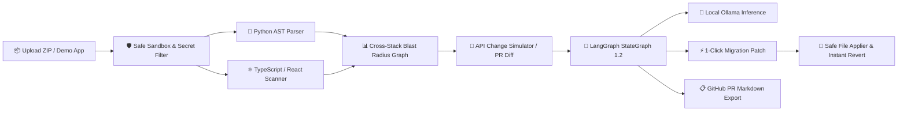

<div align="center">

# 📡 ChangeRadar
### Fullstack API Breaking Change Radar & Blast-Radius Engine
**Catch breaking backend FastAPI/Pydantic changes before they crash your React + TypeScript production apps.**

<p align="center">
  
  
  
  
  
  
  
  
</p>

[Quick Start](#-quick-start-in-60-seconds) • [Why ChangeRadar?](#-why-changeradar) • [Key Features](#-key-features) • [LangGraph & Ollama](#-langgraph--local-ollama-copilot) • [Architecture](#-architecture--dataflow) • [API Reference](#-api-endpoints)

</div>

---

## ⚡ The Problem: The Silent Cross-Stack Crash

Imagine your backend team renames or removes a response field in FastAPI:

```diff
class UserResponse(BaseModel):
    id: int
    name: str
-   email: str
+   contact_email: str
```

| Scenario | What Happens |
| :--- | :--- |
| **Backend CI Pipeline** | 🟢 **100% Passes** — Pytest passes, schemas validate cleanly. |
| **Frontend Production** | 🔴 **CRASHES** — React components throw `TypeError: Cannot read properties of undefined (reading 'email')`. |
| **With ChangeRadar 📡** | 🛡️ **PRE-FLIGHT RADAR** — Pinpoints all 4 affected UI components, renders an interactive blast radius graph, synthesizes a 1-click migration `.diff`, and drafts a Senior Staff PR review via LangGraph & local Ollama! |

---

## 🌟 Key Features

### 1. 🎯 Cross-Stack Static Analysis (Zero Code Execution)
- **Python AST Parser**: Deeply extracts FastAPI routes (`@app.*`, `@router.*`), APIRouter prefixes, query/path parameters, and Pydantic `BaseModel` field schemas.
- **TypeScript Consumer Scanner**: Recursively scans `.ts`, `.tsx`, `.js`, and `.jsx` files for route paths, Axios/fetch clients, interface type contracts, component accessors, and Vitest/Jest unit tests.

### 2. 🗺️ Interactive "Blast Radius" Dependency Graph
- An interactive, dark-themed SVG node-link tree mapping:
  $$\text{FastAPI Route} \longrightarrow \text{Pydantic Schema} \longrightarrow \text{TS Interface} \longrightarrow \text{React Component} \longrightarrow \text{Unit Test}$$
- Affected nodes dynamically pulse in amber and red when an API change or Pull Request is simulated.

### 3. ⚡ 1-Click Migration Diff & Direct File Application
- Automatically synthesizes clean, unified `.diff` migration patches for field removals, renames, type shifts, and route modifications.
- **Apply Directly to Files**: 1-click automated file refactoring with automatic safety backups (`.backups/`) and instant **Undo / Revert Changes** support.

### 4. 🦙 LangGraph 1.2 Agentic Copilot Studio + Local Ollama
- Features a compiled **6-Node LangGraph StateGraph** with conditional routing:
  - `assess_architectural_risk`: Evaluates SemVer contract stability (Major/Minor/Patch) and failure severity.
  - `synthesize_migration_guide`: Generates chronological developer migration walkthroughs.
  - `synthesize_compatibility_code`: Writes zero-downtime dual-read adapters (`normalizeContract`) and Pydantic aliases.
  - `draft_pr_review_comment`: Drafts an AI Senior Staff PR review comment with required approval gates.
  - `determine_autonomous_next_steps`: Plans autonomous flight-control next steps and test targets.
  - `interactive_developer_assistant`: Interactive Q&A chat powered by **Local Ollama (`llama3.2`)** with real-time execution trace latency metrics (ms).

### 5. 📋 "Copy for GitHub PR" Markdown Export
- 1-Click export of an audit report with risk badges, affected consumer files, line numbers, and regression test checklists ready to paste straight into a GitHub or GitLab Pull Request.

### 6. 🔒 100% Local Sandboxing & Privacy
- **Zero Cloud Uploads**: 100% local execution on your machine.
- **Zero Code Execution**: Scanned repositories are analyzed purely via static text and AST tokens (`eval` or script execution is strictly forbidden).
- **Hardened Sandboxing**: Zip Slip path traversal defense, 25MB archive limit, 100MB zip bomb defense, and automated secret filtering (`.env*`, `*.pem`, `*.key`, `node_modules`, `.venv`).

---

## 🏗️ Architecture & Dataflow



---

## 🚀 Quick Start in 60 Seconds

### Prerequisites
- **Python 3.11+**
- **Node.js v18+** & **npm**
- *(Optional for neural LLM)*: [Ollama](https://ollama.com) installed

---

### 1. Start Backend

```bash
# Navigate to backend and install dependencies
cd backend
pip install -r requirements.txt

# Launch FastAPI on port 8000
python -m uvicorn app.main:app --reload --port 8000
```
> *Backend boots on `http://127.0.0.1:8000` and creates local SQLite storage `changeradar.db`.*

---

### 2. Start Frontend

```bash
# In a new terminal, navigate to frontend
cd frontend
npm install

# Start Vite dev server on port 5173
npm run dev
```
> *Frontend opens at `http://localhost:5173` (also served directly by FastAPI at `http://127.0.0.1:8000/`).*

---

### 3. Take a 1-Click Test Drive!
1. Open **http://localhost:5173**.
2. Click **"Load Demo Sample"** in the top navigation bar.
3. The bundled demo store app (`sample_fullstack_app.zip`) will load instantly.
4. Select `Remove Response Field` &rarr; `email` &rarr; Click **"Simulate Change & Generate Radar Report"**.
5. Watch the Blast Radius graph illuminate, preview the 1-Click Migration Patch, and chat with the LangGraph Copilot!

---

## 🦙 LangGraph & Local Ollama Copilot

ChangeRadar includes native, zero-setup support for **Local Ollama** with automatic fallback to a deterministic AST engine if Ollama is offline.

```bash
# 1. Download and run Meta's compact 2GB model
ollama run llama3.2

# 2. Or run a coding specialist model
ollama run qwen2.5-coder
```

- When Ollama is active on `http://localhost:11434`, ChangeRadar displays:  
  **`🟢 🦙 Ollama Online (llama3.2)`** in the LangGraph Studio.
- Inquiries generate **100% private, on-device GPU/CPU reasoning** with zero API costs.
- If Ollama is stopped, ChangeRadar **seamlessly falls back to the local AST engine** without interruptions.

---

## 🧪 Verification & Automated Tests

ChangeRadar comes with an exhaustive test suite covering security, parsers, and agents:

```bash
# Run 12/12 passing Pytest tests
python -m pytest backend/tests

# Verify strict TypeScript compilation & build
cd frontend
npm run build
```

---

## 🔌 API Endpoints

| Method | Endpoint | Description |
| :--- | :--- | :--- |
| `GET` | `/health` | Healthcheck & local privacy status |
| `POST` | `/api/projects/upload` | Upload & sandbox a repository ZIP |
| `POST` | `/api/projects/sample` | Provision the bundled demo store project |
| `GET` | `/api/projects` | List all scanned local projects |
| `GET` | `/api/projects/{id}/endpoints` | Discovered FastAPI routes & Pydantic models |
| `GET` | `/api/projects/{id}/graph` | Cross-stack SVG Blast Radius dependency graph |
| `POST` | `/api/projects/{id}/analyze` | Run simulation (remove, rename, type shift, git diff) |
| `POST` | `/api/projects/{id}/apply-patch`| Apply migration patch to disk with safety snapshot |
| `POST` | `/api/projects/{id}/revert-patch`| Revert changes instantly from backup snapshot |
| `GET` | `/api/projects/{id}/agent-graph-spec` | LangGraph StateGraph topology specification |
| `POST` | `/api/projects/{id}/agent-query` | Interactive LangGraph + Ollama Copilot query |
| `GET` | `/api/ollama/status` | Real-time Local Ollama connectivity & model info |

---

## 📂 Repository Structure

```text
change_radar/
├── backend/
│   ├── app/
│   │   ├── api/routes/            # Endpoints, projects, reports, analysis
│   │   ├── services/
│   │   │   ├── agentic_copilot.py # LangGraph 1.2 StateGraph & conditional router
│   │   │   ├── ollama_service.py  # Local Ollama client with auto-fallback
│   │   │   ├── blast_radius.py    # Cross-stack graph generator
│   │   │   ├── fastapi_parser.py  # Python AST router & Pydantic schema parser
│   │   │   ├── typescript_parser.py# React/TypeScript AST scanner
│   │   │   ├── patch_service.py   # Unified .diff patch synthesizer
│   │   │   ├── patch_applier.py   # Atomic file patching & instant undo
│   │   │   └── zip_service.py     # Zip Slip path traversal defense
│   │   ├── database.py            # Local SQLite schema & parameterized queries
│   │   └── main.py                # FastAPI app with static frontend mounting
│   ├── samples/                   # Bundled full-stack demo application
│   └── tests/                     # 12 Pytest unit & integration tests
├── frontend/
│   ├── src/
│   │   ├── components/
│   │   │   ├── BlastRadiusGraph.tsx   # Interactive SVG node-link graph
│   │   │   ├── ChangeSimulator.tsx    # Dual-mode change simulator & PR diff
│   │   │   ├── ImpactReport.tsx       # Severity audit, checklist, copy PR
│   │   │   ├── LangGraphWorkspace.tsx # Interactive agent studio & trace inspector
│   │   │   ├── MigrationPatchModal.tsx# Unified diff viewer & 1-click applier
│   │   │   └── Header.tsx             # Project switcher & Ollama status
│   │   ├── api/client.ts              # Typed TypeScript client
│   │   └── styles/global.css          # Dark-mode design system & animations
```

---

## 📄 License

MIT © [Aniket Kumar Singh](https://github.com/aniket25042005). Open source, free for personal and commercial developer workflows.
